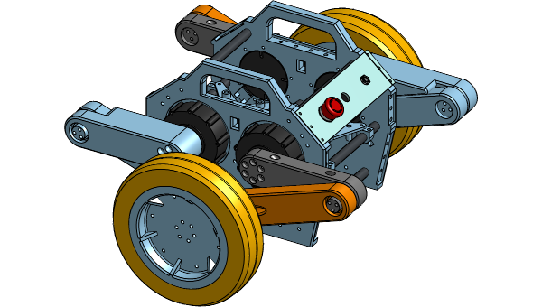

# CyberBot ROS2 Description Package

[](https://github.com/cybergear-robotics/cyberbot_description/actions/workflows/ros2-tests.yml)
[](https://opensource.org/licenses/MIT)
[](https://github.com/cybergear-robotics/ros2-cyberbot/activity)
[](https://docs.ros.org/en/jazzy/index.html)

ROS 2 description package for Cyberbot. It contains the robot's SDF model and
mesh assets, ROS launch files and description helper nodes.

The model is exported from Onshape with
[`onshape-to-robot`](https://onshape-to-robot.readthedocs.io/) using
[`sdf/config.json`](sdf/config.json). The SDF source, supporting XML, meshes,
and generated preview are kept together under `sdf/`.



## Export from Onshape

In GitHub, open **Actions → Export Onshape robot model → Run workflow**. The
workflow resolves the configured `Main` workspace, exports the `robot` assembly
into `sdf/`, downloads that Assembly's Onshape thumbnail as `sdf/robot.png`, and
commits changed model files to the selected branch. The workspace ID and
expected name are configured in `sdf/config.json`.

If the workspace is directly based on a saved Onshape version and has not been
modified since that version was created, the workflow exports the immutable
version, creates a Git tag with its name, and creates a GitHub Release. The
release contains a ZIP of the SDF, mesh assets, XML support files, and preview.
Otherwise, it exports the workspace without tagging or creating a release.

Add these repository Actions secrets before running the workflow:

- `ONSHAPE_ACCESS_KEY`
- `ONSHAPE_SECRET_KEY`

Create API keys in Onshape's developer settings and grant them access to the
Cyberbot document. Do not put credentials in `sdf/config.json` or commit them.

## Use the description

After building and sourcing the ROS 2 workspace, launch the robot description:

```bash
ros2 launch cyberbot_description description.launch.py
```
